<a href="https://thunderstore.io/c/repo/p/Mentalize/REPOPerformanceKit/"></a>

A BepInEx plugin for R.E.P.O. that exposes a set of Unity engine configuration switches through a standard BepInEx config file. It does not patch any REPO game code.

The mod does not guarantee an FPS improvement. Whether it helps, hurts, or does nothing depends on your hardware, your other mods, and the specific scenes you play. Treat every feature as a knob you may or may not want to turn.

**Live release:** [thunderstore.io/c/repo/p/Mentalize/REPOPerformanceKit](https://thunderstore.io/c/repo/p/Mentalize/REPOPerformanceKit/) — published under the author handle Mentalize, install via Thunderstore Mod Manager or by dropping the DLL into BepInEx (see [Install](#install)).

## Approach, tools, and assumptions

**Approach.** This is a *configuration kit*, not a Harmony-patch mod. Every feature is a Unity engine knob — log filtering, a scene-load `GC.Collect`, `Time.maximumDeltaTime`, `Time.fixedDeltaTime`, mipmap streaming, layer cull distances, optional FPS overlay — toggled by a BepInEx config flag and called through the public Unity API. The plugin never patches REPO's own code, never reads or modifies REPO game state, and never sends any network traffic. The deliberate intent is a transparent "every Unity perf knob in one place" tool rather than a black box of patches that other mods or REPO updates could collide with.

**Tools.**
- C# / .NET Framework 4.7.2, BepInEx 5.4.2100 (Mono build — not IL2CPP).
- Unity 2022.3.21 modules (compile-only references via `UnityEngine.Modules` NuGet). The game itself now runs on Unity 6000.3; every Unity member the plugin calls exists in both.
- No Harmony patches. No reflection on REPO classes. The only reflection is on BepInEx's private `ConfigFile.OrphanedEntries`, used once at startup to delete settings that older versions of this plugin wrote.

**Assumptions.**
- The mod does not guarantee an FPS improvement — every toggle is a knob the player may or may not want to enable, and defaults are conservative. `EnableCullDistanceBoost` and `EnableAdaptivePhysics` both default to `false`, and the cull distance `Multiplier` defaults to `1.0`, which changes nothing until the player opts in by lowering it.
- `Application.targetFrameRate` and `QualitySettings.vSyncCount` are never touched. The game writes both from its own graphics settings, so a plugin value does not survive; the options 0.1.3 had for them are removed.
- Incremental GC is decided when the game is built and cannot be switched by a plugin. The plugin reads `UnityEngine.Scripting.GarbageCollector.isIncremental` once and logs it; if that read fails on some Unity build, it logs a debug line and continues rather than failing.
- The adaptive `Time.fixedDeltaTime` feature affects the physics tick rate of objects the host simulates authoritatively over Photon, which is why it is off by default. On a networked host noticing imprecise rigidbody behaviour during FPS dips, `EnableAdaptivePhysics = false` cleanly disables it and restores the game's own tick rate.
- Each feature starts inside its own `try`/`catch`, so one feature that fails on a future game build is logged and skipped without stopping the others.
- The plugin is purely client-side: each player runs their own copy with their own config; nothing replicates over the network.

## What the DLL actually does

On plugin `Awake()`, it reads its config file and then starts each feature below. Each one also listens for its own settings changing, so a value saved on the in-game Mods page is applied right away, and turning a feature off puts back the values the game had.

- **Log filtering.** If `DisableUnityStackTraces = true`, calls `Application.SetStackTraceLogType(LogType.Log/Warning, StackTraceLogType.None)` and sets `Error/Exception/Assert` to `ScriptOnly`. If `SuppressPluginLogSpam` or `DedupeRepeatedLogs` is true, inserts a custom `BepInEx.Logging.ILogListener` in front of the listeners that exist at that moment. With `SuppressPluginLogSpam = true` the listener drops any Info/Debug/Message line whose text contains one of `SuppressedSubstrings`. With `DedupeRepeatedLogs = true` it collapses consecutive identical Info/Debug/Message lines from the same source to a `(previous message repeated N more times)` summary. Warnings/Errors/Fatals are never dropped and never collapsed.

- **Maximum delta time.** Sets `Time.maximumDeltaTime` to `MaximumDeltaTime` (default `0.1`, range `0..0.5`). `0` leaves the game's own value alone, and puts it back if the plugin had changed it.

- **GC.** If `CollectGCOnSceneLoad = true`, calls `GC.Collect()`, `GC.WaitForPendingFinalizers()`, then `GC.Collect()` again after each scene change (menu, lobby or level). The current game build changes level by loading the next scene additively and unloading the old one, so the plugin watches `SceneManager.activeSceneChanged` and `SceneManager.sceneUnloaded` and runs the pass once, half a second after the last of them. At startup it also logs `GarbageCollector.isIncremental` and the incremental time slice of the game build; it changes neither.

- **Mipmap streaming.** If `EnableTextureStreaming = true` (`[TextureStreaming] Enable` in the file), sets `QualitySettings.streamingMipmapsActive = true`, `streamingMipmapsMemoryBudget` to `MemoryBudgetMB` (clamped to `[128, 8192]`, default `1024`), `streamingMipmapsMaxLevelReduction = 2`, `streamingMipmapsMaxFileIORequests = 256`, and `streamingMipmapsAddAllCameras = true`. About 10 seconds after each scene change, and after the setting is turned on, it logs `Texture.streamingTextureCount`, `Texture.nonStreamingTextureCount` and `Texture.currentTextureMemory`. **Only textures the game imported with streaming mipmaps take part.** If the logged streaming count is 0, this setting changes nothing in that scene. On game version 0.5.3 the main menu and the one level that was checked both logged 0.

- **Adaptive fixedDeltaTime.** If `EnableAdaptivePhysics = true` (default `false`), a MonoBehaviour samples smoothed unscaled FPS once per second. Frames longer than half a second are loading hitches and are left out. If smoothed FPS falls below `DegradeBelowFps` (default 40), it remembers the game's `Time.fixedDeltaTime` and sets it to `DegradedFixedDeltaTime` (default 0.0333, i.e. 30 Hz), but only when that is larger than the game's value. If FPS then rises above `RecoverAboveFps` (default 55, treated as at least `DegradeBelowFps + 5`), or the feature is turned off, it puts the remembered value back. If the game or another mod changed `Time.fixedDeltaTime` in the meantime, that value is left alone. The plugin never writes `Time.fixedDeltaTime` at any other time.

- **Layer cull distances.** If `EnableCullDistanceBoost = true` (`[Culling] Enable` in the file, default `false`) and `Multiplier` is below `1.0`, a MonoBehaviour checks `Camera.main` twice a second and sets its `layerCullDistances` to `farClipPlane * Multiplier` (the multiplier is clamped to `0.25..1.0`) with spherical culling, for the named layers `8..31` whose name does not contain `Player`, `Enemy`, `PhysGrab`, `StaticGrab` or `Cart`. Layers `0..7` and those gameplay layers keep the camera's own distances. It reapplies when a level brings a new camera or the game moves the far clip plane, and restores the camera's own distances when turned off. **The default `Multiplier` is `1.0`, which changes nothing.** In the current game build the layers left over are mostly triggers, volumes and helper layers (the log lists them when the override is applied), so expect little or no visible change.

- **Optional FPS overlay.** If `ShowFpsOverlay = true` (default `false`), a MonoBehaviour draws a single IMGUI label in the top-left corner showing smoothed FPS, frametime in ms, and the current physics tick rate derived from `Time.fixedDeltaTime`. The text is rebuilt four times a second.

That is the complete list of things this plugin does. The per-frame parts all sit on one hidden `DontDestroyOnLoad` GameObject named `REPOPerformance`. Everything is driven by `BepInEx/config/com.mentalize.repoperformance.cfg`; the file is auto-generated with defaults on first run, and settings from older versions that are no longer read are deleted from it on the first start.

## Install

Thunderstore Mod Manager: open the [live release](https://thunderstore.io/c/repo/p/Mentalize/REPOPerformanceKit/) and click Install. Manual: extract `REPOPerformance.dll` into `<profile>/BepInEx/plugins/REPOPerformanceKit/`. Requires `BepInEx-BepInExPack` and `REPOModding-REPOConfig` (which in turn requires `REPOModding-MenuLib`); Thunderstore Mod Manager installs all three automatically, a manual install has to add them by hand.

REPOConfig adds a Mods page to the in-game settings menu that lists every option in this plugin's config file. Every setting applies as soon as you press Save Changes on that page; no restart is needed. The one that waits is `CollectGCOnSceneLoad`, which is read at the next scene change. Editing the config file by hand is only picked up when the game starts, so do that with the game closed.

## Building from source

The C# project is in [`src/`](src): one file per feature under `src/Features/`, the settings in `src/Config/PerformanceConfig.cs`, and the entry point in `src/Plugin.cs`. It needs only the .NET SDK (6 or later). BepInEx and the Unity modules come from NuGet as compile-only references (`src/NuGet.Config` adds the BepInEx feed), so no game files are required.

```bash
dotnet build src -c Release
```

The DLL lands in `src/bin/Release/net472/REPOPerformance.dll`. The plugin version is read from `version_number` in `manifest.json` at build time, so the DLL and the Thunderstore package always report the same version. A GitHub Actions job builds it on every change to `src/` or `manifest.json`.

To use the precompiled DLL: drop `REPOPerformance.dll` into `<BepInEx profile>/BepInEx/plugins/REPOPerformanceKit/` and launch the game; configuration is read from `BepInEx/config/com.mentalize.repoperformance.cfg`, generated with defaults on first run.

## Compatibility

Client-side. No Harmony patches on REPO code, no network traffic, no lobby compatibility requirement. Each player can install independently.

Note that on a networked host, the adaptive physics feature (off by default) lowers the physics tick rate of objects the host simulates authoritatively over Photon while FPS is low. If you turn it on as host and notice networked rigidbody behaviour feel imprecise during performance dips, set `EnableAdaptivePhysics = false`.

## Changelog

### 0.1.4
- Added `REPOModding-REPOConfig` as a required dependency, so the in-game Mods settings page is installed together with the plugin.
- Every setting now applies as soon as it is saved on the Mods page, with no restart. Turning a feature off puts the game's own values back. Number settings have ranges, so the page shows sensible sliders.
- Adaptive physics is now off by default and its switch is renamed to `EnableAdaptivePhysics`, so after updating it is off until you turn it on. It restores the game's own `Time.fixedDeltaTime` when FPS recovers, and a single long loading frame no longer triggers it; `BaselineFixedDeltaTime` is removed.
- Cull distance override is off by default for new installs, does nothing at `Multiplier = 1.0`, never touches player, enemy, grabbable-object or cart layers, and follows the camera across level loads and far clip plane changes.
- Removed `OverrideTargetFrameRate`, `TargetFrameRate` and `VSyncCount`: the game overwrites both values from its own graphics settings.
- Removed `EnableIncrementalGC`: incremental GC is set when the game is built and a plugin cannot switch it. Its state is now only logged.
- Log filter: `SuppressPluginLogSpam = false` now turns the substring filter off, the "repeated N more times" line is logged under the source and level it belongs to, and warnings and errors are no longer collapsed.
- The scene-load GC pass now also runs between levels. The current game build changes level without a full scene load, which 0.1.3 waited for.
- Texture streaming logs how many textures in each scene actually stream.
- Each feature starts on its own, so one that fails no longer stops the rest, and the config file is written once at startup. Another program having the file open no longer stops the plugin.
- The DLL now reports the same version as the package (it said 0.1.0 before). Settings this version no longer reads are deleted from the config file.
- Added `CHANGELOG.md` to the package so the Thunderstore Changelog tab is populated.

### 0.1.3
- Version bump (0.1.2 previously published).

### 0.1.2
- Rewrote description and README to strictly match the code's actual behaviour.

### 0.1.1
- Added `TextureStreaming` feature.

### 0.1.0
- Initial implementation (LogSuppressor, FrameRateTuner, GCTuner, AdaptivePhysics, CullDistanceBoost, FPSCounter).

## License

Copyright (c) 2026 Isaiah Anson. All rights reserved. You may use the released software for
personal, non-commercial use; copying, modifying or redistributing it requires written
permission. See [LICENSE](LICENSE).
