<a href="https://thunderstore.io/c/repo/p/Mentalize/REPOPerformanceKit/"></a>

A BepInEx plugin for R.E.P.O. that exposes a set of Unity engine configuration switches through a standard BepInEx config file. It does not patch any REPO game code.

The mod does not guarantee an FPS improvement. Whether it helps, hurts, or does nothing depends on your hardware, your other mods, and the specific scenes you play. Treat every feature as a knob you may or may not want to turn.

**Live release:** [thunderstore.io/c/repo/p/Mentalize/REPOPerformanceKit](https://thunderstore.io/c/repo/p/Mentalize/REPOPerformanceKit/) — published under the author handle Mentalize, install via Thunderstore Mod Manager or by dropping the DLL into BepInEx (see [Install](#install)).

## Approach, tools, and assumptions

**Approach.** This is a *configuration kit*, not a Harmony-patch mod. Every feature is a Unity engine knob — log filtering, GC mode, `Time.maximumDeltaTime`, `Time.fixedDeltaTime`, mipmap streaming, layer cull distances, optional FPS overlay — toggled by a BepInEx config flag and called through the public Unity API. The plugin never patches REPO's own code, never reads or modifies REPO game state, and never sends any network traffic. The deliberate intent is a transparent "every Unity perf knob in one place" tool rather than a black box of patches that other mods or REPO updates could collide with.

**Tools.**
- C# / .NET Framework 4.7.2, BepInEx 5.4.2100 (Mono build — not IL2CPP).
- Unity 2022.3.21 modules (compile-only references via `UnityEngine.Modules` NuGet).
- No Harmony patches. No reflection on REPO classes.

**Assumptions.**
- The mod does not guarantee an FPS improvement — every toggle is a knob the player may or may not want to enable, and defaults are conservative. `EnableCullDistanceBoost` for example defaults to `Multiplier = 1.0`, which changes nothing until the player opts in by lowering it.
- `Application.targetFrameRate` and `QualitySettings.vSyncCount` are left alone unless the player explicitly sets them in the config.
- `UnityEngine.Scripting.GarbageCollector.GCMode` is reached via reflection rather than a direct reference, so the plugin still loads cleanly on Unity builds where that property has been renamed or removed; it logs a warning and continues rather than failing.
- The adaptive `Time.fixedDeltaTime` feature affects the physics tick rate of objects the host simulates authoritatively over Photon. On a networked host noticing imprecise rigidbody behaviour during FPS dips, `EnableAdaptivePhysics = false` cleanly disables it.
- The plugin is purely client-side: each player runs their own copy with their own config; nothing replicates over the network.

## What the DLL actually does

On plugin `Awake()`, it reads its config file and then:

- **Log filtering.** If `DisableUnityStackTraces = true`, calls `Application.SetStackTraceLogType(LogType.Log/Warning, StackTraceLogType.None)` and sets `Error/Exception/Assert` to `ScriptOnly`. If `SuppressPluginLogSpam` or `DedupeRepeatedLogs` is true, inserts a custom `BepInEx.Logging.ILogListener` in front of the existing listeners. The listener drops any Info/Debug/Message line whose text contains one of the configured substrings, and collapses consecutive identical lines to a `(previous message repeated N more times)` summary. Warnings/Errors/Fatals are never filtered by substring.

- **Frame-rate related Unity values.** Sets `Time.maximumDeltaTime` to the configured value (default `0.1`). Optionally sets `QualitySettings.vSyncCount` (default: unchanged) and `Application.targetFrameRate` (default: unchanged).

- **GC tuning.** If `EnableIncrementalGC = true`, reflects into `UnityEngine.Scripting.GarbageCollector.GCMode` and sets it to `Enabled`. If that type or property isn't present, logs a warning and continues. If `CollectGCOnSceneLoad = true`, hooks `SceneManager.sceneLoaded` and calls `GC.Collect()`, `GC.WaitForPendingFinalizers()`, then `GC.Collect()` again on full (non-additive) scene loads.

- **Mipmap streaming.** If `EnableTextureStreaming = true`, sets `QualitySettings.streamingMipmapsActive = true`, `streamingMipmapsMemoryBudget` to the configured MB value (clamped to `[128, 8192]`, default `1024`), `streamingMipmapsMaxLevelReduction = 2`, `streamingMipmapsMaxFileIORequests = 256`, and `streamingMipmapsAddAllCameras = true`.

- **Adaptive fixedDeltaTime.** If `EnableAdaptivePhysics = true`, creates a `DontDestroyOnLoad` MonoBehaviour that samples smoothed unscaled FPS once per second. If smoothed FPS falls below `DegradeBelowFps` (default 40), sets `Time.fixedDeltaTime` to `DegradedFixedDeltaTime` (default 0.0333, i.e. 30 Hz). If it then rises above `RecoverAboveFps` (default 55), resets to `BaselineFixedDeltaTime` (default 0.02, i.e. 50 Hz).

- **Layer cull distances.** If `EnableCullDistanceBoost = true`, applies to the current scene and hooks `SceneManager.sceneLoaded` to reapply on each load. It sets `Camera.main.layerCullDistances` for layers `8..31` to `farClipPlane * Multiplier` (the multiplier is clamped to `0.25..1.0`) and turns on spherical culling, leaving layers `0..7` at the default. **The default `Multiplier` is `1.0`, which changes nothing.** Only becomes effective if you lower it in the config file.

- **Optional FPS overlay.** If `ShowFpsOverlay = true` (default `false`), creates a `DontDestroyOnLoad` MonoBehaviour that draws a single IMGUI label in the top-left corner showing smoothed FPS, frametime in ms, and the current physics tick rate derived from `Time.fixedDeltaTime`.

That is the complete list of things this plugin does. Everything is driven by `BepInEx/config/com.mentalize.repoperformance.cfg`; the file is auto-generated with defaults on first run.

## Install

Thunderstore Mod Manager: open the [live release](https://thunderstore.io/c/repo/p/Mentalize/REPOPerformanceKit/) and click Install. Manual: extract `REPOPerformance.dll` into `<profile>/BepInEx/plugins/REPOPerformanceKit/`. Requires `BepInEx-BepInExPack`.

## Building from source

The C# project is in [`src/`](src): one file per feature under `src/Features/`, the settings in `src/Config/PerformanceConfig.cs`, and the entry point in `src/Plugin.cs`. It needs only the .NET SDK (6 or later). BepInEx and the Unity modules come from NuGet as compile-only references (`src/NuGet.Config` adds the BepInEx feed), so no game files are required.

```bash
dotnet build src -c Release
```

The DLL lands in `src/bin/Release/net472/REPOPerformance.dll`. The source was restored from the 0.1.3 release build, and it compiles to the same IL as the `REPOPerformance.dll` committed here. A GitHub Actions job builds it on every change to `src/`.

To use the precompiled DLL: drop `REPOPerformance.dll` into `<BepInEx profile>/BepInEx/plugins/REPOPerformanceKit/` and launch the game; configuration is read from `BepInEx/config/com.mentalize.repoperformance.cfg`, generated with defaults on first run.

## Compatibility

Client-side. No Harmony patches on REPO code, no network traffic, no lobby compatibility requirement. Each player can install independently.

Note that on a networked host, lowering `Time.fixedDeltaTime` via the adaptive physics feature affects the physics tick rate of objects the host simulates authoritatively over Photon. If you host and notice networked rigidbody behaviour feel imprecise during performance dips, set `EnableAdaptivePhysics = false`.

## Changelog

### 0.1.3
- Version bump (0.1.2 previously published).

### 0.1.2
- Rewrote description and README to strictly match the code's actual behaviour.

### 0.1.1
- Added `TextureStreaming` feature.

### 0.1.0
- Initial implementation (LogSuppressor, FrameRateTuner, GCTuner, AdaptivePhysics, CullDistanceBoost, FPSCounter).

## License

Copyright (c) 2026 Isaiah Anson. All rights reserved. You may use the released software for
personal, non-commercial use; copying, modifying or redistributing it requires written
permission. See [LICENSE](LICENSE).
